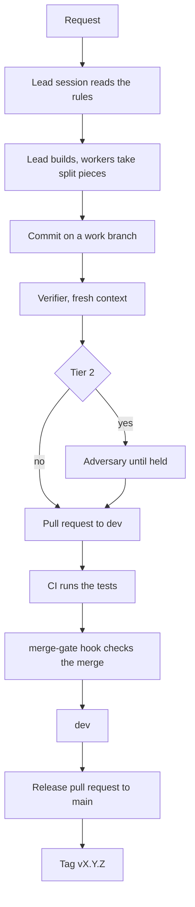

# Harness architecture

> [!tldr]
>
> The harness is the set of rules, workers, skills, hooks and checks under
> `config/claude/` and `config/codex/`. It has one version, in `VERSION` at the
> repo root. This document describes major version 0.

## Scope

The harness is this whole repo: the two folders above, their tests, the
installer, and the CI workflow that runs the tests.

Not covered, and not part of the harness version:

- Skills that are kept outside this repo.
- Plugins from a marketplace, and MCP servers.
- The memory notes that Claude Code keeps for each project.
- Terminal, editor and shell settings. They stayed in the repo that the harness
  came from (see [decision 0007](decisions/0007-own-repo.md)).

## Parts

The path of one change shows how the parts meet.

**What to notice:** only two steps are enforced by code, CI and the merge-gate
hook. Every other step is a rule that the agent must follow.

| Part        | Where                                 | Checked by                        |
| ----------- | ------------------------------------- | --------------------------------- |
| Rules       | `config/claude/CLAUDE.md`             | `tests/test_global_rules.py`      |
| Codex rules | `config/codex/AGENTS.md`              | `tests/test_codex_rules.py`       |
| Workers     | `config/claude/agents/` (6 files)     | `tests/test_worker_roles.py`      |
| Skills      | `config/claude/skills/` (12 folders)  | `tests/test_skill_frontmatter.py` |
| Hooks       | `config/claude/hooks/`                | `config/claude/hooks/tests/`      |
| Permissions | `config/claude/settings.json.tmpl`    | Not tested                        |
| Commands    | `config/claude/commands/` (2 files)   | Not tested                        |
| Mods        | `config/claude/mods/` (2 folders)     | Their own tests, not run in CI    |
| Status line | `config/claude/statusline-command.sh` | `tests/test_harness_version.py`   |
| CI          | `.github/workflows/ci.yml`            | The merge-gate hook reads it      |
| Install     | `install.sh`, `manifest.txt`          | `tests/test_install_manifest.py`  |

The [README](../README.md) says what each part does. The status line test
covers only the version segment of line 1.

Three hooks are wired in the settings template: `merge-gate.py` on
`gh pr merge`, `visual-artifacts-route.sh` on the Artifact tool, and
`second-brain-log-prompt.sh` on each prompt. `second-brain-sweep.sh` runs on
demand.

The reasons for the main choices are in [decisions/](decisions/), one short
record each. Minor findings that were logged and not fixed are in
[known-limits.md](known-limits.md).

## Conventions

### Versions

The number in `VERSION` follows semantic versioning, read as a contract with
the person who uses the harness.

| Part  | It changes when                                    | Example                 |
| ----- | -------------------------------------------------- | ----------------------- |
| MAJOR | The architecture changes, or a habit stops working | The rule root moves     |
| MINOR | Something is added, and nothing old changes        | A new skill or hook     |
| PATCH | Something is fixed                                 | A bug in a hook         |

These also count as MAJOR: a worker or a skill that is removed, a skill that is
renamed, and a short prompt that changes its meaning. A clearer sentence and a
stronger test are PATCH.

While the major is 0, the harness is still taking shape. A change that would
be MAJOR goes into a MINOR release, and its changelog entry lists it under
"Changed". Version 1.0.0 is the first release whose habits are meant to stay.

### Releases

1. Work merges into `dev` through task pull requests.
2. The release pull request from `dev` to `main` sets `VERSION` and dates the
   top entry of [CHANGELOG.md](../CHANGELOG.md).
3. After the merge, the tag `vX.Y.Z` goes on `main`.
4. On a MAJOR release, this document is rewritten for the new major.

A test fails when `VERSION` and the top changelog entry differ, when the
changelog is out of order, or when this document names another major.

### Decision records

A record is one file in `decisions/`, named `NNNN-short-name.md`. It holds the
choice in one to three sentences and what was rejected. Write one only for a
choice that is hard to reverse. A record is never edited to change its meaning:
a later record replaces it and says so.

## Gotchas

- **Live files follow the checked-out branch.** `~/.claude` holds symlinks into
  this repo's working tree. A work branch checked out in the main tree is live
  at once. The status line shows the harness version and marks this state.
- **A session loads `CLAUDE.md` without its HTML comments.** A rule that sits
  only in a comment is not a rule. The size cap counts the loaded text.
- **`settings.json` is a rendered copy.** Claude Code writes to the live file,
  so it can differ from the template. `install.sh` stops when it sees that.
- **The merge gate is not a security boundary.** It checks the normal path,
  `gh pr merge` at the start of a command.
- **Two folder names are older than the repo.** Rendered files go to
  `~/.dotfiles-rendered/` and backups to `~/.dotfiles-backup/`. The live
  settings file is a rendered copy in the first folder, so a new name would
  leave it behind.
